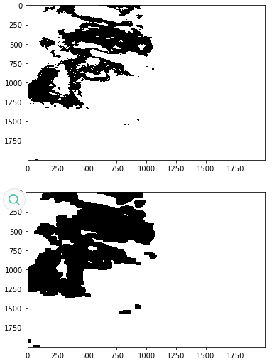
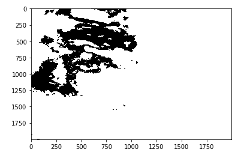
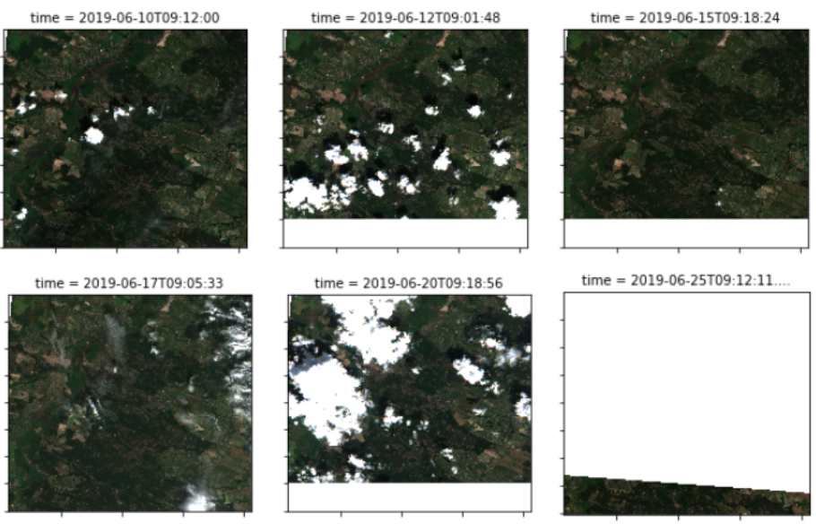
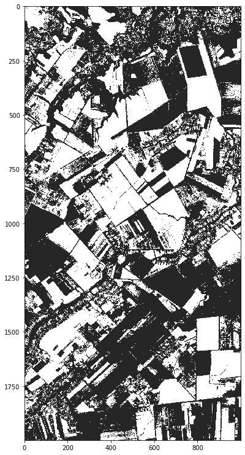
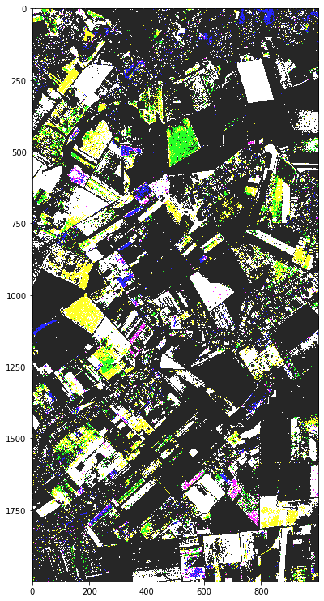
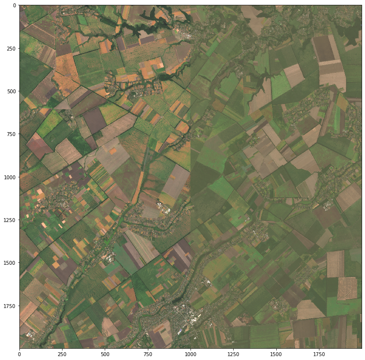
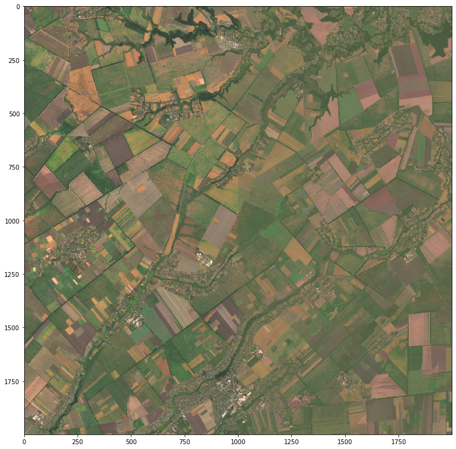

# Bachelor Thesis - Cloud-free composites of satellite images

## Structure

- `thesis/` — bachelor thesis sources and build scripts

## Abstract

The aim of this work is to develop a model for obtaining cloud-free
composites of satellite images. Sentinel-2 data for the Kyiv region are
studied together with cloud masks, image-combination methods, and regression
models for colour-space restoration between incomplete neighbouring regions.

## Summary

This thesis studies the construction of cloud-free satellite composites from
multitemporal Sentinel-2 imagery. The work focuses on improving cloud masks,
combining several observations into a single cleaner composite, and restoring
missing or visually inconsistent regions with regression and machine-learning
models.

The implementation and experiments cover:

- Sentinel-2 imagery and Open Data Cube-based processing
- cloud-mask classes from Copernicus Open Access Hub data
- morphological dilation for improving cloud and cirrus masks
- several strategies for replacing cloudy pixels with valid observations
- median aggregation across spectral channels
- colour-space restoration with regression models and neural networks

## Example Results

| Cloud mask before dilation                         | Cloud mask after dilation                         |
|----------------------------------------------------|---------------------------------------------------|
|                       |                      |

| Composite input                                    |
|----------------------------------------------------|
|                      |

| Linear regression                                  | Polynomial regression                             |
|----------------------------------------------------|---------------------------------------------------|
|                      |                     |

| Random forest                                      | Multilayer perceptron                             |
|----------------------------------------------------|---------------------------------------------------|
|                      |                     |

## Thesis Conclusions

- The COAH cloud mask does not fully cover real cloud regions and can be
  improved with morphological dilation.
- Among the compared image-combination strategies, the sliding window of size
  three is faster, while the every-pair strategy gives better visual quality.
- The improved cloud mask and compositing procedure can increase the quality of
  Earth-observation tasks based on Sentinel-2 imagery.
- For restoring incomplete satellite data, the multilayer perceptron showed the
  best quality among the tested regression and machine-learning models.

## Build

See [thesis/README.md](thesis/README.md)

The output is `thesis/index.pdf`.

## Note

This is **not the original version of the work**. It is a lightly corrected
and reformatted version based on the supplied source PDF. Grammar,
punctuation, references, links, figures, and LaTeX structure were adjusted
where necessary.

## Author

- Maksym Shylo ([@maksymshylo](https://github.com/maksymshylo))
